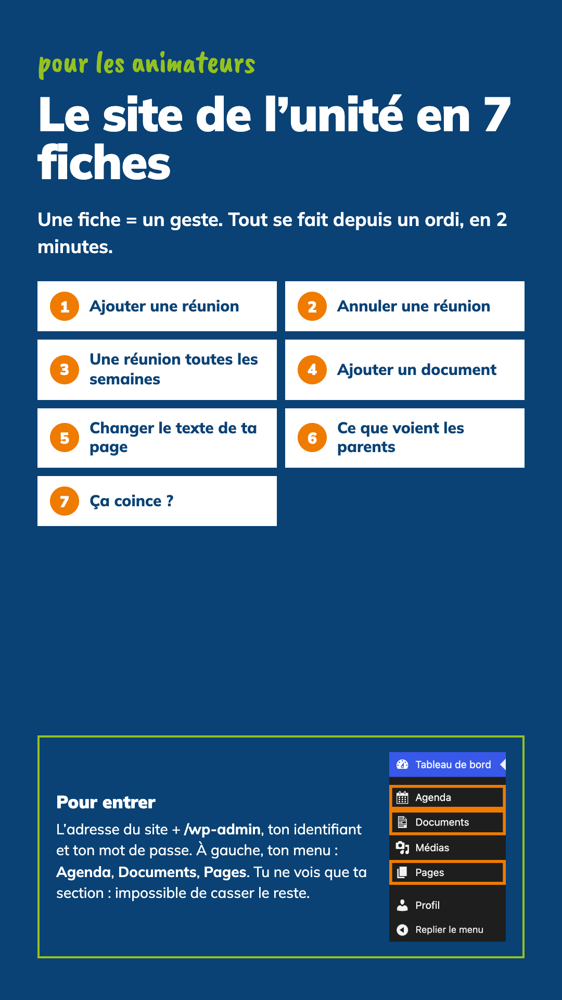
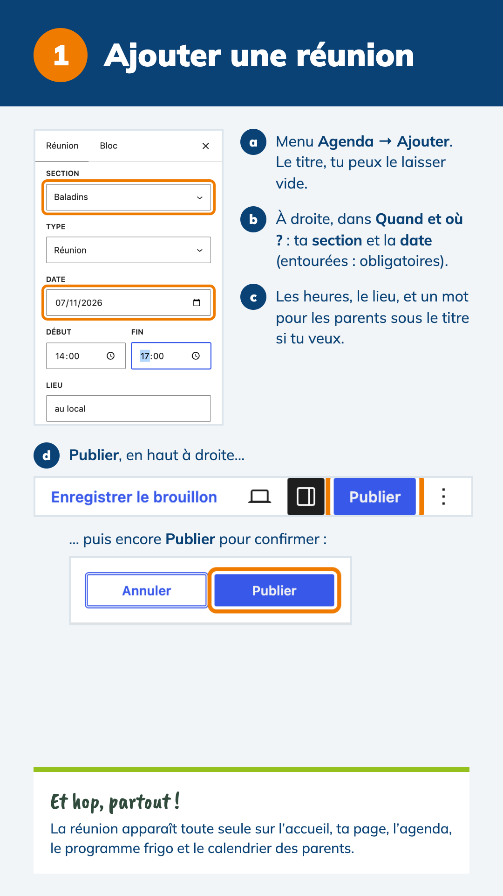
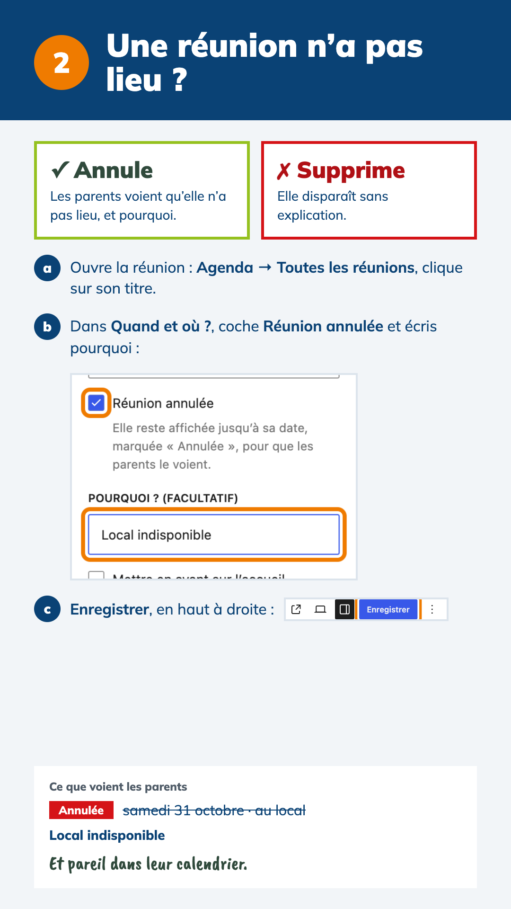
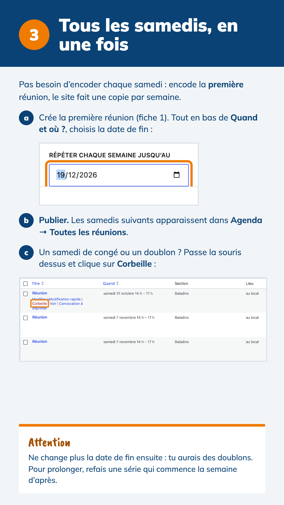
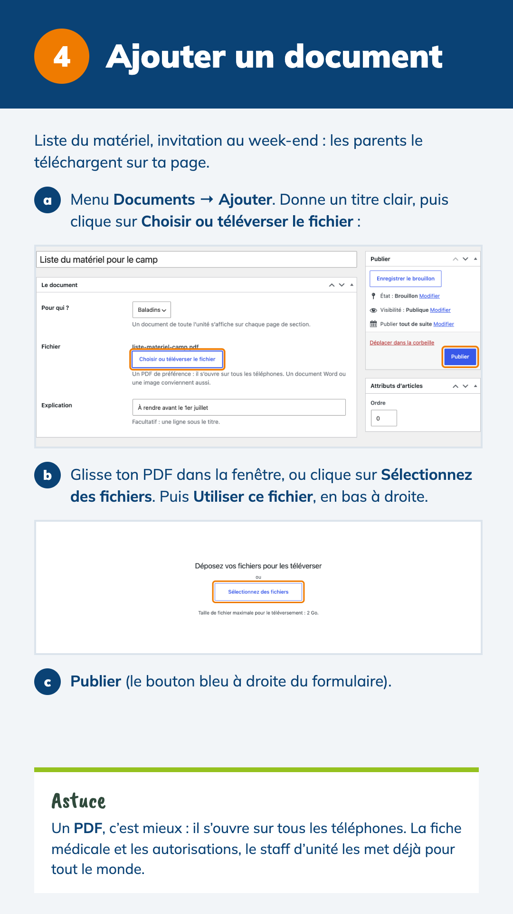
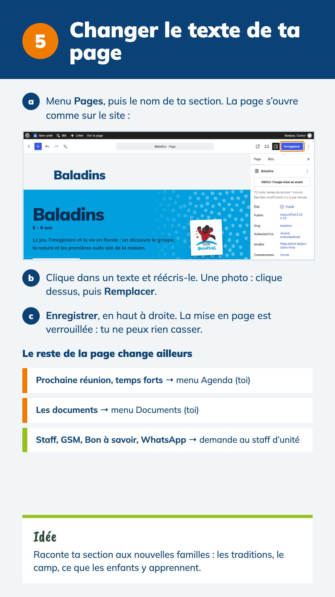
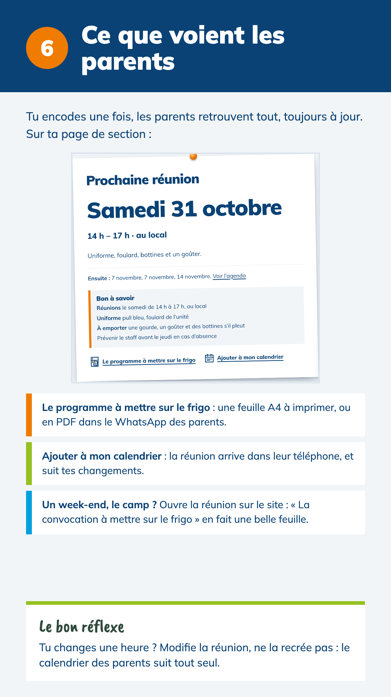
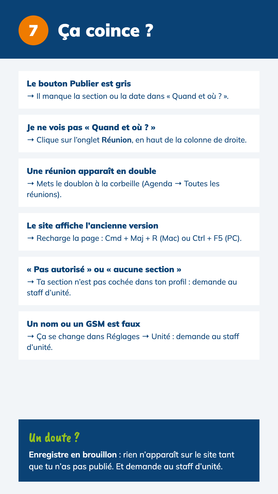

# Le site de l’unité en 7 fiches – pour les animateurs

Un geste par fiche, avec les vrais écrans de WordPress. Les fiches se lisent sur un téléphone et s’envoient en images dans le groupe WhatsApp du staff.

**[Télécharger toutes les fiches en PDF](fiches-animateurs.pdf)** (8 pages)

Le même contenu en texte, plus détaillé : [Mode d’emploi pour les animateurs](../mode-emploi-animateurs.md). Pour le staff d’unité : [Mode d’emploi pour les chefs d’unité](../mode-emploi-chefs-unite.md).

| Fiche | Ce qu’on y apprend |
|---|---|
| [0 · Couverture](00-couverture.png) | Se connecter, et le menu de l’animateur (Agenda, Documents, Pages) |
| [1 · Ajouter une réunion](01-ajouter-une-reunion.png) | Le panneau « Quand et où ? », puis Publier deux fois |
| [2 · Une réunion n’a pas lieu ?](02-annuler-une-reunion.png) | Annuler plutôt que supprimer, avec un mot d’explication |
| [3 · Tous les samedis, en une fois](03-toutes-les-semaines.png) | Répéter une réunion chaque semaine, retirer les congés |
| [4 · Ajouter un document](04-ajouter-un-document.png) | Téléverser un PDF pour les parents |
| [5 · Changer le texte de ta page](05-ta-page-de-section.png) | Réécrire la page de sa section, et qui change quoi |
| [6 · Ce que voient les parents](06-ce-que-voient-les-parents.png) | La page de section, le programme frigo, le calendrier |
| [7 · Ça coince ?](07-ca-coince.png) | Les six soucis les plus courants |

Fiches du thème 2.10.1 (octobre 2026), captures prises sur le site de démonstration.

## Mettre les fiches à jour

Les sources sont dans [`source/`](source/) : une page `.dc.html` par fiche (format du canevas Claude Design), `canvas.json` et les captures d’écran dans `source/captures/`. Après un changement d’écran dans WordPress ou dans le thème, refaire la capture concernée, adapter la fiche, puis regénérer les images et le PDF.
