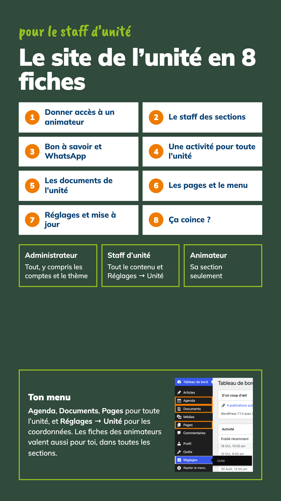
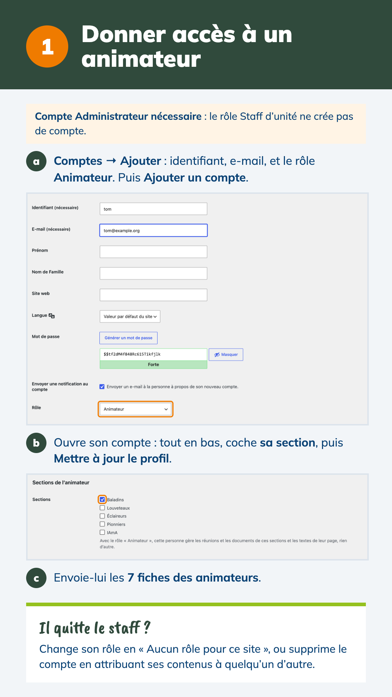
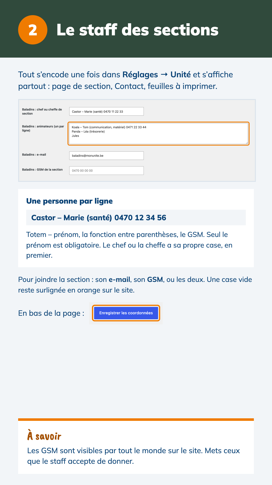
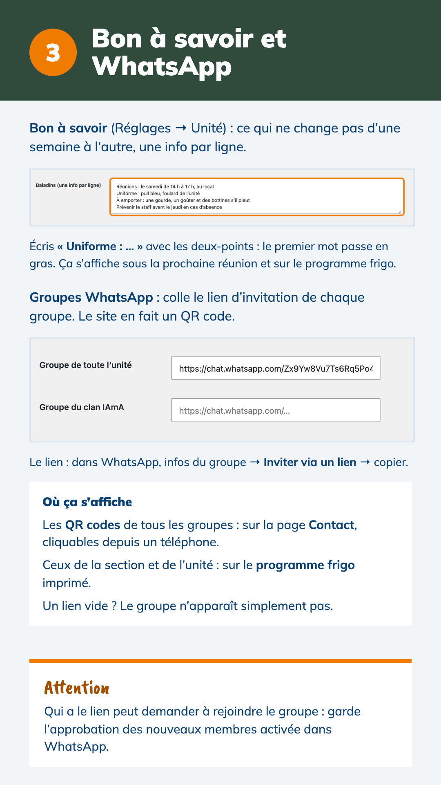
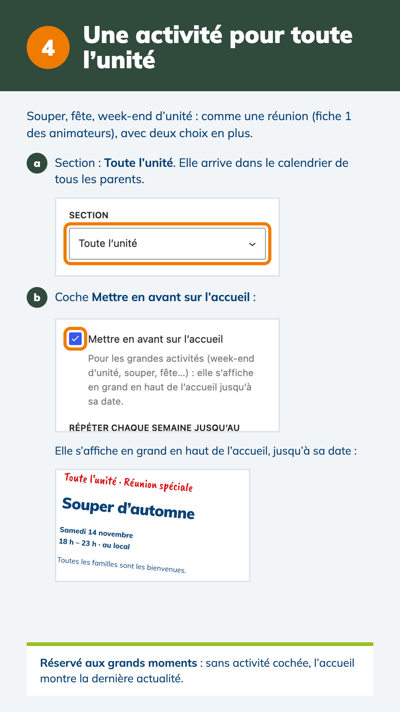
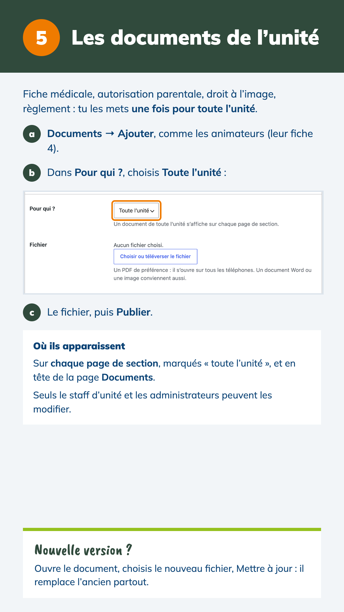
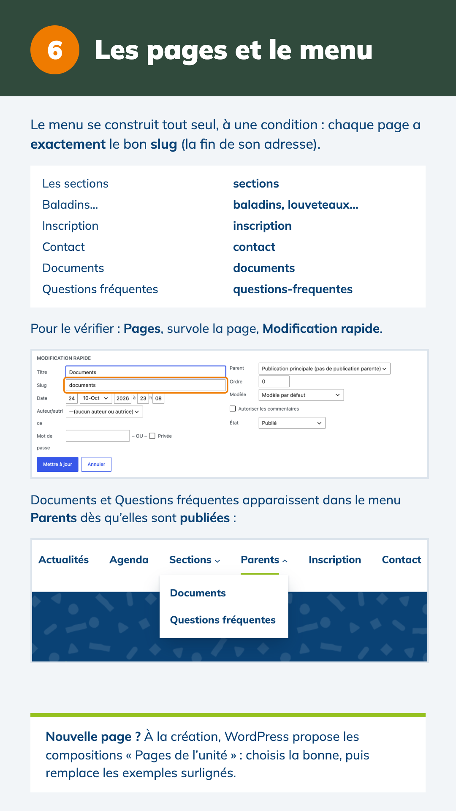
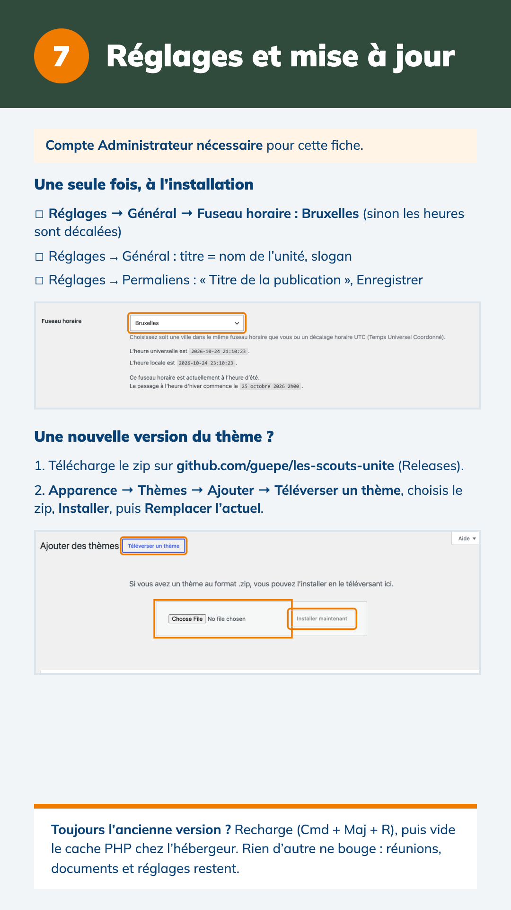
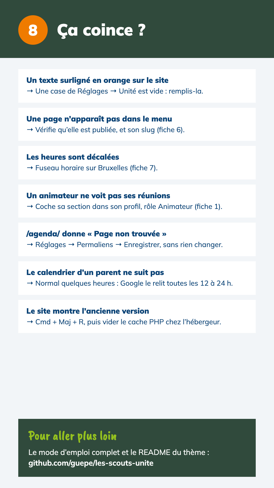

# Le site de l’unité en 8 fiches – pour le staff d’unité

Un geste par fiche, avec les vrais écrans de WordPress : ce que le staff d’unité règle une fois, et ce qu’il tient à jour pour toute l’unité. Pour les réunions et les documents d’une section, les [fiches des animateurs](../fiches-animateurs/) valent aussi pour le staff d’unité, dans toutes les sections.

**[Télécharger toutes les fiches en PDF](fiches-chefs-unite.pdf)** (9 pages)

Le même contenu en texte, plus détaillé : [Mode d’emploi pour les chefs d’unité](../mode-emploi-chefs-unite.md).

| Fiche | Ce qu’on y apprend |
|---|---|
| [0 · Couverture](00-couverture.png) | Les trois rôles, et le menu du staff d’unité |
| [1 · Donner accès à un animateur](01-donner-acces.png) | Créer son compte, cocher sa section, et quand il quitte le staff |
| [2 · Le staff des sections](02-le-staff.png) | Chefs, animateurs, e-mail et GSM de chaque section dans Réglages → Unité |
| [3 · Bon à savoir et WhatsApp](03-bon-a-savoir-whatsapp.png) | Les infos fixes de chaque section, les liens des groupes WhatsApp |
| [4 · Une activité pour toute l’unité](04-activite-unite.png) | Toute l’unité, et la mise en avant sur l’accueil |
| [5 · Les documents de l’unité](05-documents-unite.png) | Un document pour toutes les sections, et sa nouvelle version |
| [6 · Les pages et le menu](06-pages-et-menu.png) | Les slugs attendus, le menu Parents |
| [7 · Réglages et mise à jour](07-reglages-mise-a-jour.png) | Fuseau horaire, permaliens, installer une nouvelle version du thème |
| [8 · Ça coince ?](08-ca-coince.png) | Les sept soucis les plus courants |

Fiches du thème 2.10.1 (octobre 2026), captures prises sur le site de démonstration.

## Mettre les fiches à jour

Les sources sont dans [`source/`](source/) : une page `.dc.html` par fiche (format du canevas Claude Design), `canvas.json` et les captures d’écran dans `source/captures/`. Après un changement d’écran dans WordPress ou dans le thème, refaire la capture concernée, adapter la fiche, puis regénérer les images et le PDF.
